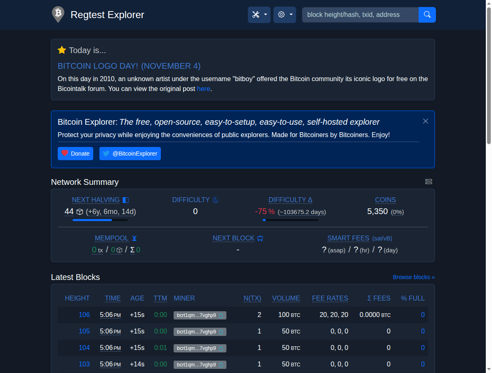
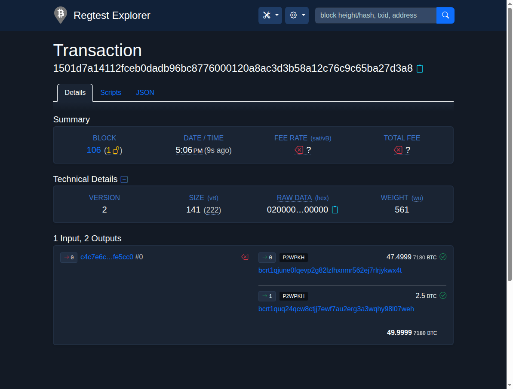

# Laborategia: Bitcoin

## Aurretiko baldintzak

- GNU/Linux makina: ordenagailu eramangarria, makina birtuala edo laborategiko PCa (LDAP kredentzialarekin sartu; `lsi` erabiltzailea soilik erabili beharrezkoa bada, `su - lsi` komandoaren bidez).
- Kode-editorea. Visual Studio Code-n, `Ctrl+Shift+V` sakatuz fitxategi hau modu atseginean bistaratzen da (batez ere irudientzat).
- Irakasgaiaren GitHub biltegia: laborategian garatutako programak igo ditzakezu.
- Docker eta Docker Compose instalatuta eta martxan (Ikus [Docker laborategia](../Docker/Docker.md)).
- `openssl` eta `xxd` instalatuta (`sudo apt install openssl xxd`).

## Sarrera

[Bitcoin](https://bitcoin.org/bitcoin.pdf) peer-to-peer sarea eta protokoloa da, bi alderdiren artean konfiantzazko bitartekaririk gabe balioa transferitzeko aukera ematen duena. Satoshi Nakamotok 2008an deskribatu zuen [Bitcoin: A Peer-to-Peer Electronic Cash System](s70423-290181-707862.pdf) artikuluan, irakasgaian jada ikusi ditugun tresnak konbinatuz (funtzio laburpenak, zifraketa asimetrikoa, sinadura digitalak) "gastu bikoitzaren" arazoa zerbitzari zentralik gabe ebazteko.

Protokoloaren elementu nagusiak hauek dira:

- **Blockchain**: bloke-katea, non bloke bakoitzak transakzio multzo bat duen. Bloke bakoitzak aurreko blokearen hash-a du, horrela blokeak kateatuta geratzen dira: bloke zahar bat aldatzeak ondorengo bloke guztiak birkalkulatzera behartuko luke.
- **Lan froga (Proof of Work)**: katera bloke berri bat gehitzeko, meatzariek balio bat aurkitu behar dute, non blokearen hash-a sareko zailtasunak zehaztutako helburu (`target`) bat baino txikiagoa den. Balio hori aurkitzeak konputazio asko behar du, baina baliozkoa dela egiaztatzea berehalakoa da.
- **Diru-zorroak, gakoak eta helbideak**: erabiltzaile bakoitzak gako-pare asimetriko bat sortzen du. Gako pribatuak transakzioak sinatzeko balio du (fondoen jabetza frogatzeko), eta helbide publikoa gako publikoari funtzio laburpenak aplikatuz eratortzen da.
- **Transakzioak eta UTXO**: kontu-saldo baten ordez, Bitcoinek "gastatu gabeko transakzio-irteeren" (UTXO - Unspent Transaction Output) eredu bat erabiltzen du. Transakzio bakoitzak aurreko transakzioen irteera bat edo gehiago kontsumitzen ditu (sarrerak) eta irteera berriak sortzen ditu, batzuk hartzailearentzat eta beste bat, hautazkoa, igorlearentzako "bueltako" diru gisa.

Benetako sarera (*mainnet*) konektatutako Bitcoin nodo oso bat muntatzeak blockchain osoa (ehunka GB) deskargatu eta balidatu behar ditu, eta benetako bloke-denborak (~10 minutu) itxaron behar dira. Laborategi honetarako **regtest** erabiliko dugu, Bitcoin Core-ren garapen eta froga lokaletarako pentsatutako modu bat: guztiz isolatuta funtzionatzen du, beste nodo batekin konektatu gabe, eta eskariaren arabera blokeak berehala meatzeko aukera ematen du. Honek diru-zorroekin, meatzaritzarekin eta transakzioekin esperimentatzeko aukera ematen digu, benetako dirurik erabili edo itxaron gabe.

## Instalazioa eta konfigurazioa

Bitcoin Core zuzenean sisteman konpilatu edo instalatu ordez, `bitcoind` nodo bat edukiontzi batean exekutatuko dugu, [`ruimarinho/bitcoin-core`](https://hub.docker.com/r/ruimarinho/bitcoin-core) irudia erabiliz.

Deskargatu irudia:

```bash
docker pull ruimarinho/bitcoin-core
```

Exekutatu edukiontzi bat nodoarekin `regtest` moduan:

```bash
docker run -d --name bitcoind-regtest ruimarinho/bitcoin-core -regtest=1 -server=1 -fallbackfee=0.0002
```

> Zertarako balio dute `-regtest=1` eta `-server=1` parametroek?

`-fallbackfee` parametroak transakzioetarako berezko komisio bat ezartzen du: benetako sare batean komisioa sarearen azken jardueratik abiatuta estimatzen da, baina gure `regtest` lokalean, sortu berria, oraindik ez dago estimazio hori egiteko nahikoa daturik.

Egiaztatu edukiontzia martxan dagoela:

```bash
docker ps
```

`bitcoin-cli` terminaleko bezeroa jada instalatuta dago irudian. `bitcoind` prozesua edukiontziaren barruan `bitcoin` erabiltzailearekin exekutatzen denez, hori adierazi behar da `docker exec` bidez komandoak exekutatzean:

```bash
docker exec -u bitcoin bitcoind-regtest bitcoin-cli -regtest getblockchaininfo
```

> Aurreko emaitzan, zenbat bloke ditu kateak? Zergatik?

`docker exec -u bitcoin bitcoind-regtest bitcoin-cli` komando bakoitzean ez errepikatzeko, terminalean alias bat defini dezakezu (terminala irekita dagoen bitartean bakarrik irauten du):

```bash
alias bitcoin-cli="docker exec -u bitcoin bitcoind-regtest bitcoin-cli -regtest"
bitcoin-cli getblockchaininfo
```

## Diru-zorroak eta helbideak

Sortu diru-zorro (wallet) bat nodoan:

```bash
bitcoin-cli createwallet "labw"
```

Sortu helbide berri bat diru-zorroaren barruan:

```bash
bitcoin-cli getnewaddress
```

Gorde helbidea aldagai batean berrerabiltzeko:

```bash
ADDR=$(bitcoin-cli getnewaddress)
echo $ADDR
```

Helbide bakoitzak gako-pare bat du atzean. Ikusteko:

```bash
bitcoin-cli getaddressinfo $ADDR
```

> Zein eremuk du gako publikoa?

> Zein eremuk du gako publikoari laburpen funtzioak aplikatzearen emaitza?

Egiazta dezagun eskuz helbide hori benetan gako publikoari laburpen-hash bat aplikatuz lortzen dela. Ordeztu `PUBKEY` goian lortutako `pubkey` eremuaren balioarekin:

```bash
echo -n "PUBKEY" | xxd -r -p | openssl dgst -sha256 -binary | openssl dgst -rmd160
```

> Bat dator emaitza `getaddressinfo`-ren `witness_program` eremuarekin? Zer gertatuko litzateke helbidearekin gako publikoaren karaktere bakarra aldatuko balitz?

Zure gako pribatuek inoiz ez lukete zure diru-zorrotik atera behar. Defektuz, Bitcoin Core-ren diru-zorro bat diru-zorro "HD" (hierarkikoki determinista) bat da: gako pribatu maisu bakar batetik helbide guztiak eratortzen dira. Ikusteko (**Froga-ingurune honetan soilik, inoiz ez benetako diru-zorro batean**):

```bash
bitcoin-cli listdescriptors true
```

> `desc` eremuan, zein zati dagokio gako pribatu maisuari (`tprv`-rekin hasten da)? Norbaitek gako hori lortuko balu, zer egin lezake diru-zorroaren helbide guztiei lotutako funtsekin?

## Meatzaritza eta lan froga

`regtest`-en ez dago lehiatzeko beste meatzaririk, beraz zuzenean eska diezaiokegu nodoari blokeak meatzeko eta bloke bakoitzaren saria helbide zehatz batera joan dadin:

```bash
bitcoin-cli generatetoaddress 101 $ADDR
```

> Zergatik eskatzen ditugu 101 bloke 1 ordez (Pista: `bitcoin-cli getbalance`, eta bilatu informazioa meatze-sarien "heldutasun-epeari" buruz)?

Egiaztatu diru-zorroaren saldoa:

```bash
bitcoin-cli getbalance
```

Aztertu minatutako azken blokea:

```bash
HASH_BLOCK=$(bitcoin-cli getbestblockhash)
bitcoin-cli getblock $HASH_BLOCK
```

> Zein eremuk du aurreko blokearen hasha (`previousblockhash`)? Zertarako balio du eremu honek?

> Zein eremuk du `nonce`-a? Zertarako erabiltzen da lan frogan?

> Zein eremuk islatzen dute meatze-zailtasuna (`bits`, `difficulty`)? Zergatik da hain baxua zailtasuna `regtest`-en?

`previousblockhash` eremuari bloke batetik bestera jarraituz, zein blokera iristen zara azkenean? Zeharkaldia script baten bidez automatiza dezakezu, edo eskuz hainbat aldiz egin.

## Transakzioak eta UTXOak

Sortu bigarren helbide bat, beste erabiltzaile bat adieraziko duena:

```bash
ADDR_2=$(bitcoin-cli getnewaddress "destiny")
```

Bidali kopuru bat diru-zorrotik helbide berrira:

```bash
TXID=$(bitcoin-cli sendtoaddress $ADDR_2 1.5)
echo $TXID
```

Transakzioa orain mempool-ean dago, hau da, bloke batean sartzeko zain:

```bash
bitcoin-cli getmempoolentry $TXID
```

> Zer gertatuko litzateke, transakzio hau baieztatu aurretik, diru kopuru bera beste transakzio desberdin batean gastatzen saiatuko bagina (gastu bikoitza)? Nork saihesten du hori benetako sare batean, non benetan hainbat meatzari lehiatzen diren?

Minatu bloke bat transakzioa baieztatzeko:

```bash
bitcoin-cli generatetoaddress 1 $ADDR
```

Kontsultatu jada baieztatutako transakzioa:

```bash
bitcoin-cli gettransaction $TXID
```

Sarreren eta irteeren xehetasun osoa ikusteko (UTXO eredua), transakzioa baieztatzen duen blokearen hasha ere behar dugu:

```bash
HASH_BLOCK=$(bitcoin-cli getbestblockhash)
bitcoin-cli getrawtransaction $TXID true $HASH_BLOCK
```

> Zenbat sarrera (`vin`) eta zenbat irteera (`vout`) ditu transakzioak?

> Irteeretako bat `$ADDR_2`-ra doa. Zein helbidera doa beste irteera, eta zer adierazten du?

> Kalkulatu sarreren balio osoaren eta irteeren balio osoaren arteko aldea. Zeri dagokio alde hori?

UTXO bat (Unspent Transaction Output, edo gastatu gabeko transakzio-irteera) transakzio baten ondoren erabilgarri geratzen den eta oraindik gastatu ez den bitcoin kopurua da. Diru-zorro baten saldoa ez da kontu bateko zenbaki bakarra, baizik eta bere helbideei lotutako UTXO guztien batura.

## Sarea blokeen esploratzaile batekin esploratzen

Blockchain-a `bitcoin-cli` erabiliz baino modu erosoagoan bistaratzeko, blokeen web-esploratzaile bat zabalduko dugu gure nodoarekin konektatuta, Docker Compose erabiliz. Lehenik gelditu aurreko edukiontziak eta ezabatu behar den guztia.

Jarri terminala karpeta berri batean eta sortu `docker-compose.yml` fitxategi bat honako edukiarekin:

```yaml
services:
  bitcoind:
    image: ruimarinho/bitcoin-core
    container_name: bitcoind-explorer
    command:
      - -regtest=1
      - -server=1
      - -rpcallowip=0.0.0.0/0
      - -rpcbind=0.0.0.0
      - -rpcuser=labw
      - -rpcpassword=labw
      - -fallbackfee=0.0002

  explorer:
    image: getumbrel/btc-rpc-explorer:v3.5.1
    depends_on:
      - bitcoind
    environment:
      BTCEXP_HOST: 0.0.0.0
      BTCEXP_BITCOIND_HOST: bitcoind
      BTCEXP_BITCOIND_PORT: 18443
      BTCEXP_BITCOIND_USER: labw
      BTCEXP_BITCOIND_PASS: labw
      BTCEXP_NETWORK: regtest
    ports:
      - "3002:3002"
```

Fitxategi honek bi zerbitzu definitzen ditu: `bitcoind`, `regtest`-eko nodo berri batekin (aurreko ataletako `bitcoind-regtest` edukiontziarekiko independentea), eta `explorer`, [btc-rpc-explorer](https://github.com/janoside/btc-rpc-explorer) web-aplikazioa, `bitcoind` zerbitzura konektatzen dena bere zerbitzu-izena host gisa erabiliz (Docker Compose-k edukiontziak elkarren artean izenez ebazten dituen sare bat sortzen du).

Zabaldu zerbitzuak:

```bash
docker compose up -d
```

Minatu zenbait bloke eta egin transakzioren bat nodo berri honetan, 3, 4 eta 5. ataletako urratsak errepikatuz. Ordeztu komando nagusia:

```bash
alias bitcoin-cli="docker exec -u bitcoin bitcoind-explorer bitcoin-cli -regtest -rpcuser=labw -rpcpassword=labw"
```

Ondoren bisitatu esploratzailea <http://localhost:3002> helbidean.

> Bilatu esploratzailean sortu duzun bloke bat eta transakzio bat. Bat al dator informazioa `bitcoin-cli` bidez lortzen zenuenarekin?

> Nabigatu atzera, bloke bakoitzetik, 0 altuerako blokera iritsi arte. Nola deitzen da bloke berezi hori?





Zerbitzuak gelditzeko:

```bash
docker compose down
```